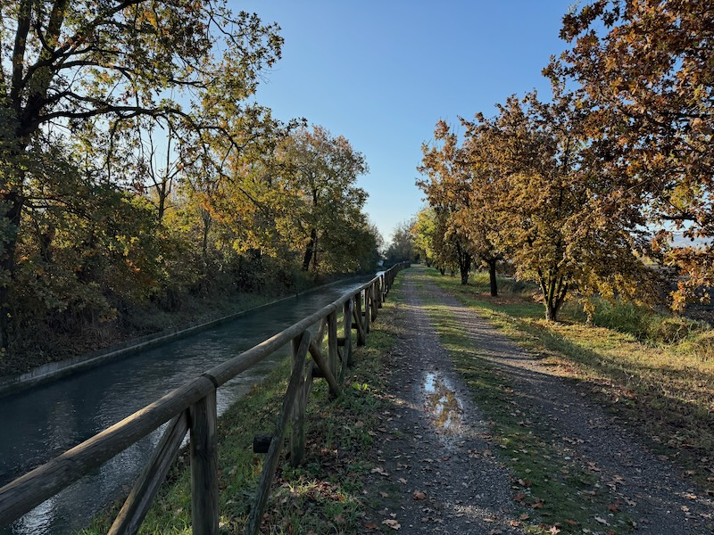
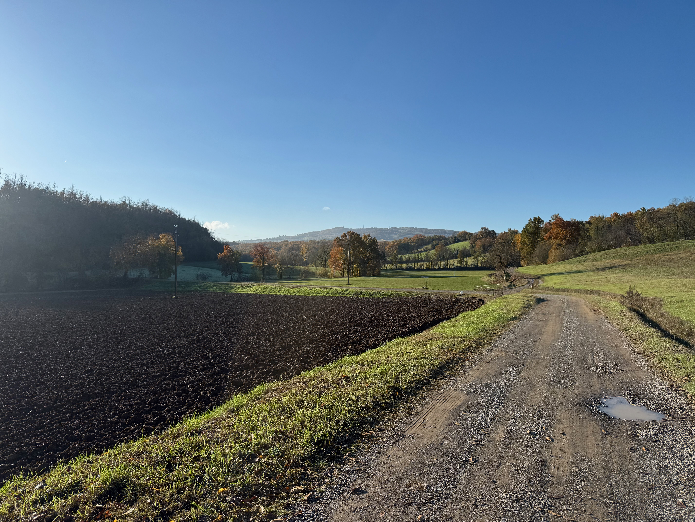
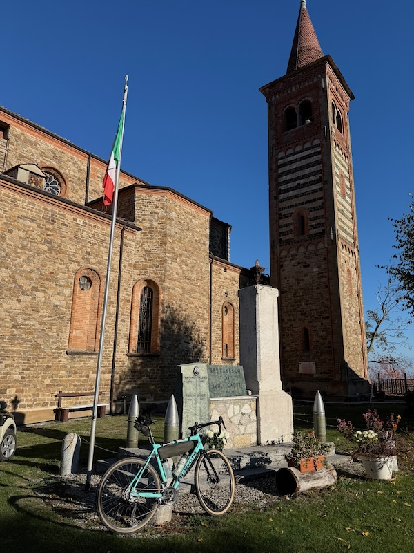
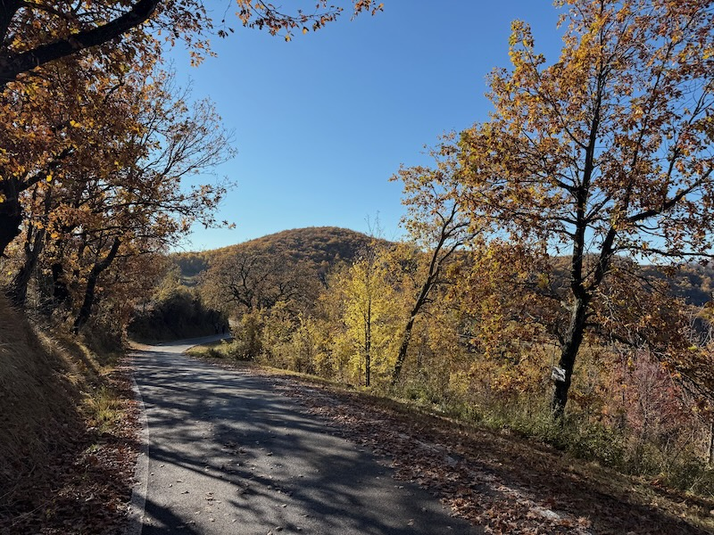
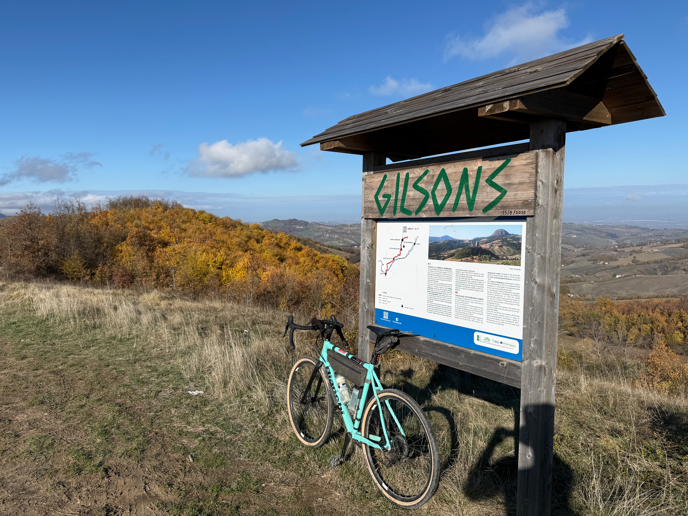
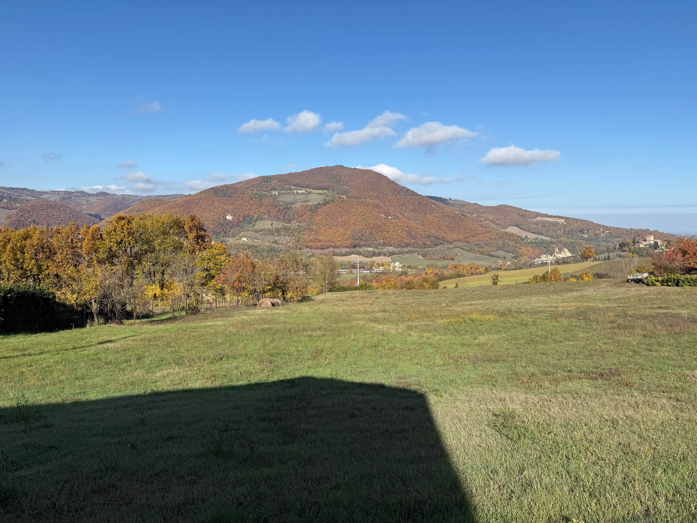

The roads are a tiny bit damp, so most of the roadies are indoors with their rollers, leaving the roads to the knobbly-tyres crew. 

The day started out lovely, with a perfect cloudless sky to set off the autumn colours. 

Flawless gravel continues; this is where we begin to climb up towards that ridgeline ahead. 

This is the church at Rezzanello, which is popular enough as a wedding venue for there to be signs begging people not to throw rice. There is also a memorial monument to the village's fallen sons, with an intriguing gap where a name has been removed. No doubt there is a story there.

From Rezzanello I rode along the ridge, enjoying more autumn colours, before heading down to Travo.

Unfortunately at this point a bitterly cold wind came up. I was glad of my spare outer layer and [Hestra over-gloves](), but it was still unpleasant, and my legs decided they had simply had enough. However, I didn't fancy busy Saturday traffic on the main road, so I was stuck with my route via Rallio and [Veano](), and ground my way up the side of the valley excruciatingly slowly. It didn't help that my bone-conduction headphones ran out of battery at this point, leaving me with nothing to distract me and keep me motivated.

That last pic is of the [Pillerone](https://www.trailforks.com/trails/pillerone/), one of the big MTB hills in these parts, and also looking very colourful. The trails would have been far too muddy after a solid week of rain, though, so it will have to wait for another day. 

From here it was back down to town via back-roads and cycle paths, so at least the pain was worth it, in terms of avoiding car traffic. Once I got down into the plain I also found some shelter from the wind, but the hot shower at home was still very welcome.

76 km, 974m elevation gain, a nice round 3k calories as estimated by my Apple Watch — and back home in time for lunch.