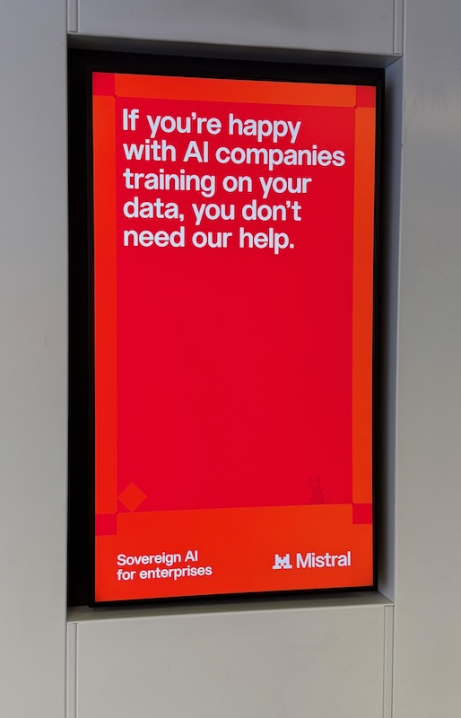

I have written before about how [one of the key requirements for AI to be successful in a particular domain is that the data and information flows of that domain be made legible to automated systems](). This is why AI success stories to date tend to be in the enterprise, and specifically in enterprise IT. This is a domain where enormous amounts of work have already been done to make everything machine-readable in service of traditional (deterministic) automation. There are also clear incentives for companies to continue this effort and bring ever more work within the scope of the AI tools, where it can either be automated entirely, removing human effort and the attendant costs, or partially, supporting a greater focus by human experts on more value-added work.

Problems arise when services and products require this legibility, or, perhaps worse for users' experience, assume it is already present. 

> My kingdom for a search engine that will just. Do. What. I. Fscking. Tell. It.
> 
> I want to search for pages that match two words, both of them, in that precise sequence. Back in the day you could just put quotes around the words, job done. No more.
> 
> Now everything has to be "helpful" and include pages with the words separated, only one of the words, or even neither one of the two words that I specifically put in quotes, depending on the presence of a synonym, or the phase of the moon or whatever. 
>
> And all the search engines are as bad as each other on this. Just give me Boolean operators, I beg of you. Hide them behind an "advanced" button; I'd even pay a subscription for a SQL interface. Please, take my money! 

-- [Me on Bluesky](https://bsky.app/profile/theriotnrrd.eurosky.social/post/3n24lf6amcm2f)

These "helpful" features are killing digital search, at least for humans, who are [retreating into digital dark forests](https://www.newyorker.com/culture/infinite-scroll/the-death-knell-of-digital-search) where we can talk to each other in peace, without being bothered by bots that appear to be more rudely intrusive, the less well-informed and helpful they are.

# Hiding among the trees

Beyond manners, there are other reasons to be doubtful about the consequences of making our world legible to the machines to this extent. In the personal realm, the main concerns are privacy ("ewww, creepy!") and return on effort. At work, meanwhile, the concern is that if an employee allows their job to fall within the realm of automation, they will no longer have a job. This is the main thrust of this FT article, [*Do we really want to make our work machine-readable?*](https://www.ft.com/content/9df59321-a7a0-4ed7-b02f-60cfc5fdcb2e?syn-25a6b1a6=1)[^1]

> It is one thing for Anthropic to feed Claude (its own product) as much information about its organisation as possible; it would be another thing entirely for a company to cede so much power to a system it did not own. Workers, too, would lose the monopoly on something that is currently valuable (the tacit institutional knowledge built up inside their heads).

This paragraph alludes to, but does not fully explore, an aspect which I am starting to see come up more and more in my professional conversations, and that is [resilience](https://www.snaplogic.com/blog/ai-readiness-business-case-strategiegipfel-it-management).

Resilience, or rather the lack of it, in critical business systems is in the news right now. Just in the past week, we have seen a total ground stop of US air traffic, which seems to have been caused by a [single equipment failure](https://www.bbc.com/news/articles/cqx2wyvyr3zzo). Then [Outlook (and related services such as Teams) went down](https://www.bbc.com/news/articles/c5gm3g9ldz8xo), and while we have not seen a post-mortem yet at time of writing, the widespread assumption is that the cause was ultimately an inability to roll back to a known-good state once failures started to occur. Yesterday [customers of US banks were having trouble logging in to online banking systems](https://www.bbc.com/news/articles/cj752wvqneq6o). And what prompted me to write this piece is that I woke up this morning to news that [United was having issues with a takeoff-weight calculation system which meant none of its planes could take off](https://time.com/article/2026/11/16/united-airlines-system-outage-technology-issue-flight-delays/).

Commentators are rightly pointing out that the common factor in all of these outages is excessive optimisation of the underlying systems. A system that is designed to work only in ideal conditions will fail, often catastrophically, in the face of the unexpected. Resilience, meanwhile, is expensive: spare capacity is by definition idle. Of course, expense is relative: what is the cost of an outage which does not occur? Or rather, what is the probable benefit that can be offset against the certain cost involved in averting the outage?

# Resilient Intelligence

In our fallible world, companies planning to capture all of the knowledge which currently resides in employees' heads into an AI system should consider, not only the upsides, but also the potential downsides. Creative, motivated employees will find ways around outages. Flight's not taking off? Maybe I can drive or take a train. Email's down? I'll pick up the phone. AI's down and the employees who had the knowledge were "downsized" to provide the savings to pay for the AI? Ah.

And that's not even considering that AI adoption is not a one-time decision. AI services come with significant ongoing costs, both subscription fees for the models themselves (and the ancillary harnesses that are required to keep them on-task and doing useful work), and the cost of the tokens that enable the models to work. To hand off a critical business process to AI is to attach a running meter to it. And that may well be fine for that particular use case, but the ongoing cost must be factored into the calculation as much as the up-front price tag.

I think we will see a swing back to more local, self-managed AI, rather than reliance on distant mega-providers. There are three factors that will drive this transition:

- **Data privacy**: Privacy is sometimes written off as a somewhat abstract concern, but in many parts of the world, there are national privacy regulations with serious teeth that mean it must be considered as a core part of service design — or else.
- **Information security**: Leakage of intellectual property or other critical business information into the model is definitely a concern, especially in regulated industries like pharma. 
- **Business model**: Not all business processes will be worth the cost of frontier models, and given the difficulty of forecasting AI costs, the distinction will not always be clear up front, so companies may well err on the side of caution — or on the principle of "once bitten, twice shy".
- **Resilience and business continuity**: Today, a cloud outage affects email. Tomorrow, might an equivalent outage actually prevent a company from operating at al?

An AI model that operates on fully-owned and -controlled infrastructure is one that is reasonably secure against leaks. Once the hardware has been amortised, the main ongoing cost is power — which is not nothing, especially for AI models, but operates according to models that are well-understood by, and predictable to, the CFO. And while it may or may not be more resilient in technical terms (the hyperscalers are always going to have more impressive kit and dedicated staff), cloud outages tend to be binary: when the service is down, it is fully down. Local services in the hands of competent staff can usually be recovered at least in some degraded state to enable basic continuity of service.

Much as with public cloud services, none of this is an argument not to use AI tools at all. It is, however, an argument to be intentional about both benefits and costs — including the ones that are not purely and straightforwardly financial, such as the risks to business continuity. The sorts of IT executives and senior architects that I talk to for work are starting to think seriously about these topics, and I expect them to start to show up more and more over the coming months, as we come to a more mature understanding of how best to extract value from AI models.

***

[^1]: It is surely darkly ironic that the author's name is Sarah O'Connor, too close for comfort to Sarah Connor of *Terminator* fame.